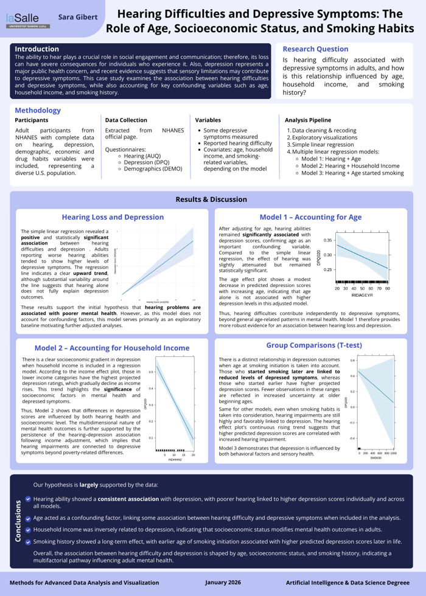

# Beyond Hearing 

**Hearing difficulties and depressive symptoms: the role of age, socioeconomic status and smoking habits.**

A statistical study in **R** using US public health survey data (NHANES 2017–2018). Research project for the **Methods for Advanced Data Analysis and Visualization** course, Bachelor in Artificial Intelligence & Data Science, La Salle – Universitat Ramon Llull (Oct 2025 – Jan 2026).

  



## Research question

Is hearing difficulty associated with depressive symptoms in adults, and how is this relationship influenced by age, household income and smoking history?

## Key finding

Across all analyses, worse self-reported hearing was **significantly associated with higher depressive symptom scores**, even after adjusting for age, household income and smoking habits.

## Methods

1. **Data:** four NHANES questionnaires (hearing, depression, demographics, smoking) merged by participant.
2. **Cleaning:** NHANES missing-value codes (7, 9, 77, 99…) set to NA, invalid cases removed, age groups built.
3. **Exploratory analysis:** distributions by age, sex, ethnicity, education, income and smoking, plus hearing vs. depression visualizations (ggplot2).
4. **Statistical models:**
   - Correlation test and simple linear regression
   - Multiple linear regression adjusting for age and sex, household income, and age started smoking
   - One-way ANOVA with post-hoc comparisons and t-tests between hearing groups
5. **Additional exploration:** correlation matrix and PCA.

## My contribution

I handled the data cleaning and the statistical analysis.

## Authors

Sara Gibert Medina · Júlia Escoriza Pons

## Files

```
beyond_hearing_analysis.ipynb   Full analysis in R (Jupyter / Google Colab)
docs/paper.pdf                  Research paper
docs/poster.pdf                 Conference-style poster
docs/report.pdf                 Full project report
data/                           Where to place the NHANES files (see data/README.md)
```

## Run it

1. Download the four NHANES 2017–2018 files into `data/` (instructions in [`data/README.md`](data/README.md)).
2. Open the notebook with an R kernel (Jupyter or Google Colab) and run the cells in order.

R packages used: `ggplot2`, `dplyr`, `tidyverse`, `haven`, `scales`, `GGally`, `effects`.
